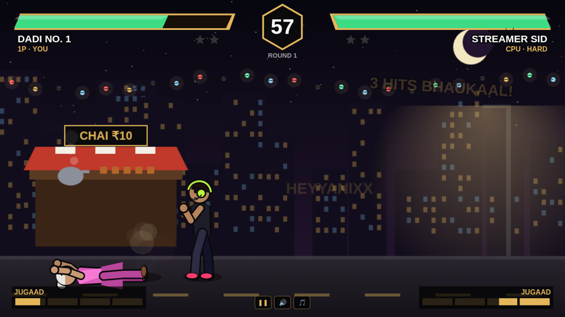

# NUKKAD KNOCKOUT 🥊☕

**Desi meme street-fighting game in your browser.** Chaiwala vs Dadi vs Streamer — chappal boomerang, Auto Ram, Smash That Like.
Made by **HEYYANIXX** · Plain HTML5 Canvas + vanilla JavaScript (Vite) · no game engine, no images, no audio files.

▶ **Play:** https://heyyanixx-fight.sites.tab.bot

> All characters are fictional parodies; not affiliated with any real person. (Only exception: HEYY ANISH = the owner of this game 😎)



## Features
- **10 fighters**, each with its own stats, move names and a unique **JUGAAD** (super) move:
  | Fighter | Group | JUGAAD super |
  |---|---|---|
  | Chaiwala Chhotu | Desi | Ketli Tsunami (hot chai wave) |
  | Auto Anna | Desi | Auto Ram (rickshaw drives across the screen) |
  | Dadi No. 1 | Desi | Chappal Boomerang (hits going AND coming back) |
  | Headshot Hero | Battle royale | One Tap Headshot (crosshair locks on — crouch to dodge!) |
  | Jelly Wall Jojo | Battle royale | Jelly Wall (moving wall, eats projectiles) |
  | Loot Goblin | Battle royale | Pan-demic (3 spinning frying pans) |
  | Streamer Sid | Creator | Smash That Like (like-buttons rain from the sky) |
  | Vlogger Vicky | Creator | Ring Light Flash (blinds + stuns) |
  | Carry Mintu *(parody)* | Creator | Yalgaar Scream (+ Roast Mic stun, Beep Blast) |
  | **HEYY ANISH** *(secret boss)* | Owner | 8-3 Badla (8-hit rush) + LOL Emote stun |
- **Modes:** 1P vs CPU (Easy / Normal / Hard) and 2 players on one keyboard
- **Fighting system:** walk, jump, crouch, block (hold back; crouch-block lows), punch (THAPPAD), kick (LAAT), grab (PAKAD) + throw escape, specials, combos, air attacks, taunt, JUGAAD meter, combo damage scaling, hit-stop, screen shake, slow-mo KO
- **Rules:** 100 HP, 60-second rounds, best of 3, TIME KHATAM decision, PERFECT
- **3 stages:** Chai Tapri Night, Patang Terrace, Nukkad Junction (railway — trains shake the screen)
- **Chaos events:** cow walks through and launches fighters 🐄, power cut, rain, kite "BO KATA", "Bhai ne bola" LAG and low-gravity moon fights
- **Meme energy:** Hinglish combo callouts (DHISHUM! BHAUKAAL! JHAKAAS! KHATAM!), random meme pop-ups, "BRUH." freeze-frame when a super misses, confetti KO, meme captions on the win screen
- **Meme Mode:** big heads + double speed
- **Sound:** every sound and the looping desi beat are generated live with the Web Audio API (no copyrighted audio). Music + SFX toggles
- **Mobile:** touch joystick + buttons, landscape with "rotate your phone" prompt, PWA (installable, works offline)
- **Extras:** share-your-win card (WhatsApp / share sheet), local win leaderboard, unlockable secret boss

## Controls
| | VS CPU (1 player) | 2P — Player 1 | 2P — Player 2 |
|---|---|---|---|
| Move / jump / crouch | WASD or arrows | WASD | Arrows |
| Block | hold back | hold back | hold back |
| THAPPAD (punch) | J or Z | F | K / Num1 |
| LAAT (kick) | K or X | G | L / Num2 |
| PAKAD (grab) | I or C (or J+K) | H | O / Num3 |
| JUGAAD (super, full bar) | L / Space / V | T | P / Num0 |
| Taunt (+meter) | U / B | R | U / Num4 |

Specials: **→ + THAPPAD** rush · **→ + LAAT** flying kick · **↓ + LAAT** sweep (only a crouch-block stops it).
Combos: **P,P,P** · **P,P,K** · **K,K** · **↓P, K** · grabbed? press PAKAD fast to escape.
Pause **Esc / P** · Music **M** · SFX **N**. Secret boss: beat the CPU once (or tap the ??? tile 5 times, or type ANISH on the select screen).

## Setup — English
```bash
git clone https://github.com/heyyanixx/nukkad-knockout.git
cd nukkad-knockout
npm install        # installs Vite (the only dependency)
npm run dev        # open the local URL it prints
npm test           # 14 automated tests (game logic + built site)
npm run build      # production build into ./site
npm run preview    # serve the build locally
```
Deploy: upload the `site/` folder to any static host (GitHub Pages, Netlify, Vercel, Cloudflare Pages). Paths are relative, so it works in a sub-folder too.

## Setup — Hinglish
1. Repo clone kar: `git clone https://github.com/heyyanixx/nukkad-knockout.git` aur `cd nukkad-knockout`
2. `npm install` — bas Vite install hoga, aur kuch nahi
3. `npm run dev` — jo link aaye (jaise http://localhost:5173) browser me khol, game chalu 🎮
4. `npm test` — saare tests chalenge (game ke rules + build check)
5. `npm run build` — final game `site/` folder me ban jayega. Ye folder kisi bhi free hosting pe daal de (GitHub Pages / Netlify) — online ho jayega
6. Naya fighter add karna hai? `src/roster.js` me ek entry copy karke naam, colour, speed, super badal de

## How it works (code map)
```
src/moves.js    frame data for every move (startup/active/recovery, damage, combos)
src/roster.js   the 10 fighters (stats, looks, move names, super type)
src/fighter.js  fighter state machine + physics (60 fps fixed step)
src/game.js     rounds, timer, hit detection, blocking, damage, supers, projectiles, stage events
src/ai.js       CPU brain with Easy / Normal / Hard profiles (reaction time, block, punish, combos)
src/render.js   all drawing: procedural fighters (no sprites), stages, effects, HUD
src/audio.js    Web Audio synth: SFX + generated desi beat
src/input.js    keyboard maps + touch joystick/buttons
src/main.js     screens, game loop, pause, results, share, PWA registration
tools/balance.mjs  CPU vs CPU win-rate check for every pair
```
The game simulation (`game.js`, `fighter.js`, `ai.js`) has no DOM code, so it runs in Node for tests.

## Next update ideas
- More fighters: Sigma Uncle, Delivery Bhaiya, Engineering Wala, Topper Kid, Pani Puri Bhaiya, Aunty Next Door
- More stages: Gully cricket street, Hostel room, Wedding baraat
- Online play with a friend (WebRTC peer-to-peer + tiny room-code server)
- Gravity-flip event, arcade/story mode, sprite art pass

## Credits
Inspired by browser fighting games. **Original code & art** (everything is drawn with code). The reverse-engineering study of a similar game that inspired this is in [docs/ANALYSIS.md](docs/ANALYSIS.md); no code, art, sound or names were copied.

MIT License © 2026 HEYYANIXX
